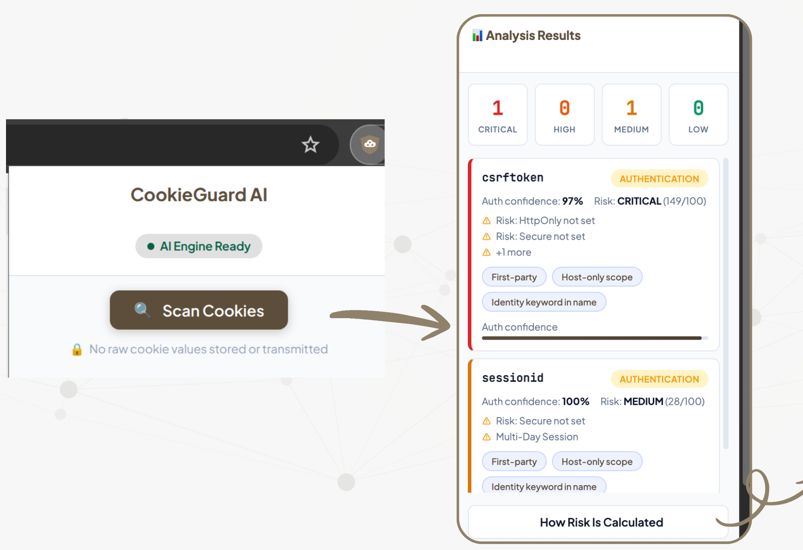

# CookieGuard AI + CookieGuard CI

**Find insecure authentication cookies automatically — in your browser, your Playwright tests, and your CI pipeline.**

Catch insecure authentication-cookie configurations before they reach production.
CookieGuard CI checks server declarations and browser observations, explains the
evidence, and fails CI only for confirmed policy violations. Everything runs
locally. No account, API key, cloud classifier, or telemetry is required.

CookieGuard CI extends the original CookieGuard AI project and its MIT-licensed
work. 🏆 **Winner — Girls Who Code Challenge 2026**:
[award announcement](https://girlswhocode.com/news/gwc-challenge-2026-winners),
[original demo](https://www.youtube.com/watch?v=_PhzLN31C04).
The Chrome extension, research artifacts, and original project history remain.

**Release target: CookieGuard CI v0.1.0 — public beta.** The npm CLI, Playwright
adapter, and GitHub Action will ship together from this repository, using the
same security engine. npm packages and a CI release tag have **not** been
published. The commands below use this checkout. Package names must be checked
for ownership and availability before publication.

## One cookie, one actionable failure

A developer identifies `session_id` as the application's authentication cookie.
The server omits HttpOnly. CookieGuard reports:

```text
HIGH CG001 — "session_id": Missing HttpOnly
  Fix: Set HttpOnly on the authentication cookie at the server.
Result: FAILED — 1 confirmed violations at or above high
```

This confirms a configuration violation. It does not demonstrate an XSS attack.
Classifier suggestions without developer evidence stay review items.

## Quick start: CLI

Requirements: **Node 24 LTS**, npm, and Git. The CLI itself needs no browser,
Python, or native model runtime. A full contributor installation also installs
test tooling and the optional ONNX adapter's development dependency.

```bash
git clone https://github.com/aiscihub/cookieguard-ai.git
cd cookieguard-ai
# Check out the CookieGuard CI implementation branch/tag when available.
npm ci
npm run demo
```

In another terminal in this checkout:

```bash
# Pass: exit 0
npx --no-install cookieguard-ci scan http://127.0.0.1:3000/secure --auth-cookie session_id

# Deliberately fail: exit 1
npx --no-install cookieguard-ci scan http://127.0.0.1:3000/missing-httponly --auth-cookie session_id

# JSON to stdout and an owner-readable file; deliberately exits 1
npx --no-install cookieguard-ci scan http://127.0.0.1:3000/missing-secure --auth-cookie session_id --format json --output report.json

npx --no-install cookieguard-ci --help
```

Stop the demo with Ctrl+C. For a CLI-only checkout installation:

```bash
npm ci --omit=dev --omit=optional --ignore-scripts
npm run build
```

The future published-package experience is `npx cookieguard-ci scan URL`; do not
use that command to fetch an unverified package under the proposed name today.

The CLI performs a bounded GET and observes Set-Cookie headers, including up to
five same-origin redirects. It does **not** execute JavaScript or log in. Use
Playwright for authenticated browser workflows. No outgoing Cookie or
Authorization headers are generated by the CLI.

| Option | Behavior |
| --- | --- |
| `--auth-cookie NAME` | Exact authentication-cookie name; repeat for multiple names. A missing expected name makes the audit incomplete. |
| `--fail-on high` | Minimum confirmed severity; choices: info, low, medium, high, critical. |
| `--format text\|json`, `--output FILE` | Value-free findings and metadata; JSON supports baselines. |
| `--input FILE` | Read a local cookie metadata array or legacy `{ "cookies": [...] }` export. Values are discarded after transient feature extraction; arbitrary fields are not copied. |
| `--allowed-samesite lax,strict` | Allowed explicitly declared values; add `none` for a reviewed cross-site flow. |
| `--require-explicit-samesite` | Treat observed absence as a medium policy violation. Store-only evidence remains unknown. |
| `--require-host-only` | Treat observed Domain sharing as a medium policy violation. |
| `--max-lifetime-days 30` | Maximum remaining client-cookie lifetime; violation severity is medium. |
| `--baseline FILE` | Compare compatible JSON reports for protection regressions. |
| `--timeout-ms 10000` | Total HTTP deadline; range 100–60000 ms. |
| `--allow-origin https://your-test-app.example` | Explicit authorization for that developer-controlled origin. Never authorize third-party services you do not control. |

Exit codes are **0** completed/pass, **1** completed/confirmed policy failure,
and **2** incomplete scan or invalid configuration. A pass means the observed
cookies passed the configured checks, not that the application is secure.

Only loopback addresses and exactly `localhost` are allowed by default. The
scanner rejects URL credentials, queries/fragments, cross-origin redirects,
remote private/special IPv4 addresses, and remote IPv6 targets. Nonlocal DNS is
pinned to a validated public IPv4 address for the scan. Request paths are never
printed. No public website is visited by the demo or tests.

## Quick start: Playwright

From a full development installation:

```bash
npx --no-install playwright install chromium
npm run test:playwright
```

The example starts and stops its own loopback application. Stop any manually
running demo on port 3000 first. On Linux CI, use
`npx --no-install playwright install --with-deps chromium`.

Inside an ordinary Playwright test:

```js
import { test, expect } from '@playwright/test';
import { startCookieAudit, assertCookiePolicy } from '@cookieguard/playwright';

test('session-cookie policy', async ({ context, page }) => {
  const audit = startCookieAudit(context, {
    origins: ['http://127.0.0.1:3000'],
    policy: { authCookies: ['session_id'], failOn: 'high' },
  });
  try {
    await page.goto('http://127.0.0.1:3000/login');
    await page.getByRole('link', { name: 'Create secure demo session' }).click();
    await expect(page).toHaveURL(/\/secure$/);
    assertCookiePolicy(await audit.evaluate());
  } finally {
    audit.dispose();
  }
});
```

Replace the demo link with your existing sign-in steps and session assertions.
CookieGuard does not manage credentials. `evaluate()` stops collection; call it
after the awaited workflow. For already-authenticated pages use
`auditPage(page, { policy: { authCookies: ['session_id'] } })`. SameSite
declaration then remains unknown. See [the complete example](examples/playwright/)
and [API details](packages/playwright/README.md).

The collector observes only configured origins but does not restrict the test's
network access. Use a controlled browser test with service workers blocked where
possible. It does not enable tracing, HAR, screenshots, or storage-state exports.

## Quick start: GitHub Actions

This repository includes a [complete workflow](.github/workflows/cookieguard-ci.yml)
that installs Node 24 and Chromium, tests the toolkit and packed npm consumers,
then exercises passing, deliberately failing, and incomplete Action audits.
After checking out this implementation
and starting your application, its minimal audit step is:

```yaml
# Workflow permissions: contents: read
# In jobs.<job>.steps, after checkout and application startup:
- uses: ./action
  with:
    target: http://127.0.0.1:3000/secure
    auth-cookies: session_id
    fail-on: high
```

The action creates a Step Summary and sanitized JSON artifact before enforcing
the exit status. Do not put credentials or tokens into inputs. The action
installs only production dependencies in its own checkout, so run contributor
tests before invoking `./action` locally. See [Action usage](action/README.md).
After maintainers release a reviewed `ci-v0.1.0` tag, consumers can reference
`aiscihub/cookieguard-ai/action@ci-v0.1.0` or its immutable commit SHA. The release
tag is pending coordinated publication. Hosted Linux/Chromium tests and the
Action's 0/1/2 outcomes and artifact uploads have passed; see the
[validation evidence](docs/CI_VALIDATION.md).

## Supported checks

| Rule | Check | Default decision |
| --- | --- | --- |
| CG001 | Missing HttpOnly | High if authentication identity is confirmed |
| CG002 | Missing Secure | High if authentication identity is confirmed |
| CG003 | Explicit SameSite outside policy | Medium; does not prove CSRF |
| CG004 | Domain sharing | Review; medium with `requireHostOnly` |
| CG005 | Lifetime greater than configured maximum | Medium |
| CG006 | Invalid __Host-/__Secure- declaration | High with confirmed identity and unambiguous header evidence; browser rejection is kept separate |
| CG007 | Comparable protection regression | High; baseline is opt-in |
| CG008 | Candidate/unknown authentication role | Review only |
| CG009 | Missing/ambiguous evidence | Review only |

Use `--fail-on medium` to enforce medium policies. Missing flags on unconfirmed
cookies are review, never confirmed failures. Domain scope alone does not prove
subdomain takeover. A browser's effective SameSite does not establish that the
server explicitly declared it. Deletion headers are excluded from active checks.

## Architecture and original Chrome extension

The small npm workspace contains `packages/core`, `packages/cli`, and
`packages/playwright`. Build copies the existing engine from
`extension-standalone/engine.js`; feature extraction and rule classification
retain one source of truth. Its only source modification is a guarded Node
export. The popup, model, research results, and legacy Python backend stay intact.
CI uses its own conservative policy explanations, not the extension's attack
simulations or probability-based vulnerability gate.

Default classification is explicitly labeled `rule`. Optional local ONNX
classification preserves the existing model and feature order; it is always
triage, never identity proof, and errors never silently fall back. See
[core API and ONNX usage](packages/core/README.md),
[architecture/audit](docs/CI_ARCHITECTURE.md), and
[the original README](docs/ORIGINAL_README.md).

To install the original standalone Chrome extension:

1. Download/clone this repository.
2. Open `chrome://extensions/` and enable **Developer mode**.
3. Select **Load unpacked**, then the `extension-standalone/` folder.
4. Visit a site you are authorized to inspect, open CookieGuard AI, and select
   **Scan Cookies**. The popup shows **AI Engine Ready** or **Rule-Based Mode**.



The [historical website report](https://aiscihub.github.io/cookieguard-ai/report.html),
[project summary](PROJECT_SUMMARY.md), original evaluation files in `models/`,
and [legacy test instructions](test/README.md) are preserved.

## Evaluation and limitations

[CI validation](docs/CI_VALIDATION.md) records measured local and hosted results and exact
commands. The controlled benchmark is reproducible with `npm run benchmark`.
It verifies known configurations, not real-world authentication detection.
There is no independently labeled real-world validation dataset for this release.

The original research reported 95.7% accuracy and 90.4% authentication precision
on synthetic evaluation data; its detailed historical metrics remain in the
original README and model artifacts. Different stored model/evaluation versions
have different numbers. None are CI's real-world detection accuracy.

Main limits: explicit cookie identification is still needed for strict CI;
browser evidence cannot recover missed response headers; header scans cannot
prove browser acceptance; partitioned/ambiguous cookies receive conservative
review; no public-suffix analysis, exploit testing, CSRF-defense validation, or
server-side session-expiry measurement is performed. Chromium is the tested
browser for this initial release.

## Security and privacy

CI never serializes cookie values, raw Set-Cookie headers, request credentials,
legacy analysis contexts, or arbitrary exception messages. Values are used only
in memory for model features. Reports contain selected metadata and fixed
explanations. No telemetry or cloud inference; the optional Node ONNX adapter
disables runtime telemetry before loading it. If your application initializes
ONNX first, set `ORT_DISABLE_TELEMETRY=1` before starting the process.

Cookie names, domains, and paths may themselves be sensitive; review reports
before sharing. The original extension's legacy JSON export includes cookie
values and is not a sanitized CI artifact. See [PRIVACY.md](PRIVACY.md) and
[SECURITY.md](SECURITY.md). Do not supply real storage-state exports as fixtures.

## Contributing and troubleshooting

```bash
npm ci
npx --no-install playwright install chromium
npm run release:check
```

- **Exit 2 / expected cookie missing:** the HTTP endpoint may not set the cookie
  until login or JavaScript runs. Use the Playwright collector around login.
- **SameSite unknown:** begin collection before the server response; do not
  replace unknown evidence with the browser's default.
- **Browser missing:** run the Playwright installation command above. On Linux,
  install its OS dependencies with `--with-deps`.
- **Port 3000 in use:** stop the manual demo before running Playwright tests.
- **TLS error:** use a trusted local certificate. There is no insecure-TLS bypass.
- **Nonlocal target refused:** use an exact authorized origin; private/special
  remote addresses and remote IPv6 remain unsupported in this version.
- **Sandbox blocks loopback/browser:** run tests in a development environment
  permitted to bind loopback ports and launch Chromium.
- **Module missing after production-only install:** run `npm run build`; restore
  dev dependencies with `npm ci` before running tests.

See [CONTRIBUTING.md](CONTRIBUTING.md), [release notes](CHANGELOG.md), and
[release procedure](docs/CI_RELEASE.md). License: [MIT](LICENSE).
