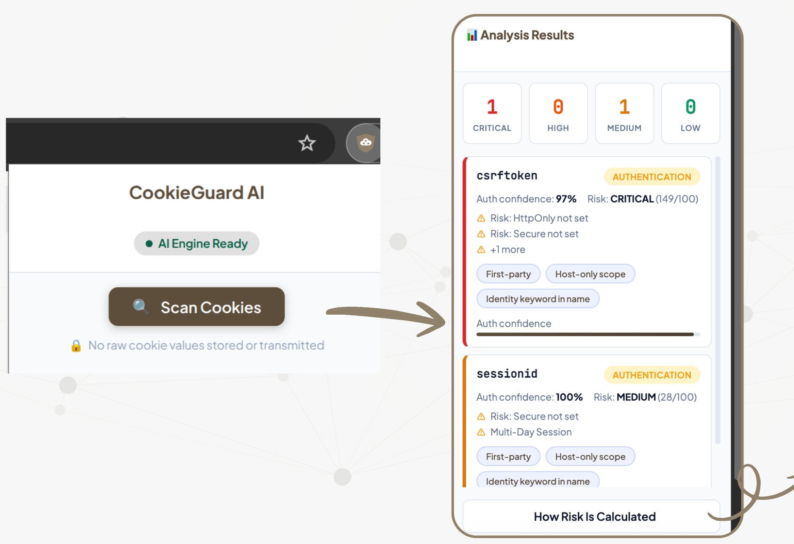

<div align="center">

# CookieGuard AI

### Cookie security checks for AI browser agents, MCP clients, tests, and CI.

**A successful agent login is not a secure session cookie.**

[](https://pypi.org/project/cookieguard-browser-use/)
[](https://pypi.org/project/cookieguard-browser-use/)
[](https://www.npmjs.com/package/cookieguard-ci)
[-5c4ee5?style=flat-square)](packages/mcp/README.md)
[](integrations/browser-use/docs/install.md)
[](https://github.com/browser-use/browser-use)
[](https://github.com/aiscihub/cookieguard-ai/actions/workflows/cookieguard-ci.yml)
[](LICENSE)
[](https://girlswhocode.com/news/gwc-challenge-2026-winners)

**[Browser Use integration](integrations/browser-use/README.md) · [MCP server](packages/mcp/README.md) · [CI guide](docs/CI_GUIDE.md) · [Website](https://aiscihub.github.io/cookieguard-ai/)**

[Quick start](#quick-start) · [How it works](#how-it-works) · [Your policy](#your-policy-decides-what-fails) · [What it checks](#what-it-checks) · [MCP](#use-it-from-an-mcp-client) · [More tools](#more-ways-to-use-cookieguard) · [FAQ](#faq) · [Documentation](#documentation)

<code>pip install --pre cookieguard-browser-use</code>

</div>

> [!NOTE]
> CookieGuard for Browser Use is a community integration, not an official Browser Use
> package. Audit only applications you are authorized to test.

<div align="center">

<br />


<sub>Real run: Claude (<code>claude-opus-5-5</code>) drives a Browser Use agent through the same login twice.
The insecure app gets <b>FAIL — CG001</b> (exit 1); the secure app gets <b>PASS</b> (exit 0).
<a href="integrations/browser-use/docs/demo-and-tests.md">Recording and test evidence</a></sub>

<br /><br />

</div>

---

Your AI agent can log in to an app successfully while the session cookie it receives
is still unsafe, for example readable by JavaScript because it lacks `HttpOnly`.
CookieGuard watches the browser the agent drives, checks the authentication cookies
against your policy, and returns **PASS / FAIL / INCOMPLETE** with rule IDs,
explanations, and fixes.

The decision comes from the local CookieGuard engine and is enforced by your code,
never by the model. Cookie values stay on your machine: they never reach the model,
logs, or reports.

## Quick start

### Install

Needs **Python 3.11+, Node.js 24+, and Chrome or Chromium**. Version 0.1.0b1 is a
pre-release, so include `--pre`:

```bash
pip install --pre cookieguard-browser-use
```

### Try the demo

Runs a real Browser Use agent against a local login app, with no API key needed:

```bash
python -m cookieguard_browser_use.demo   # insecure: FAIL CG001 (exit 1) · secure: PASS (exit 0)
```

### Add it to your agent

```python
from browser_use import Agent, BrowserProfile, BrowserSession, Tools
from cookieguard_browser_use import CookieGuardAudit

audit = CookieGuardAudit(
    allowed_origins=['http://127.0.0.1:3000'],  # exact origins you are authorized to test
    auth_cookies=['session_id'],                # the real session cookie name(s)
    fail_on='high',
)
session = BrowserSession(browser_profile=BrowserProfile(
    keep_alive=True,                            # required: Agent.run() otherwise closes the browser
    enable_default_extensions=False,            # avoid the bundled cookie-consent extension
    allowed_domains=audit.browser_allowed_domains(),
))
tools = Tools()
audit.register_tools(tools)                     # optional agent-visible check

await session.start()
await audit.start(session)                      # before the login
agent = Agent(task=..., llm=..., browser_session=session, tools=tools,
              sensitive_data={'http://127.0.0.1': {'login_password': '...'}})
await agent.run()
result = await audit.finish()                   # decided by the CookieGuard engine
await session.kill()

print(result.summary)
result.assert_policy()                          # raises CookiePolicyError on FAIL or INCOMPLETE
```

`assert_policy()` raises on FAIL or INCOMPLETE even if the agent never called the
audit tool, or reported success.
[Install guide](integrations/browser-use/docs/install.md) · [Real-model example](integrations/browser-use/examples/agent_login.py)

## How it works

<picture>
  <source media="(max-width: 600px) and (prefers-color-scheme: dark)" srcset="integrations/browser-use/docs/how-it-works-dark-mobile.svg">
  <source media="(max-width: 600px)" srcset="integrations/browser-use/docs/how-it-works-light-mobile.svg">
  <source media="(prefers-color-scheme: dark)" srcset="integrations/browser-use/docs/how-it-works-dark.svg">
  
</picture>

CookieGuard reads the agent's browser over its own connection. It sees both what the
server declared (`Set-Cookie`) and what the browser stored. The published CookieGuard
engine then evaluates that evidence locally.
[Details](integrations/browser-use/docs/how-it-works.md)

## Your policy decides what fails

<picture>
  <source media="(max-width: 600px) and (prefers-color-scheme: dark)" srcset="integrations/browser-use/docs/policy-dark-mobile.svg">
  <source media="(max-width: 600px)" srcset="integrations/browser-use/docs/policy-light-mobile.svg">
  <source media="(prefers-color-scheme: dark)" srcset="integrations/browser-use/docs/policy-dark.svg">
  
</picture>

`fail_on` sets the line: a confirmed finding at or above it fails the run; anything
below is reported. Only cookies you name in `auth_cookies` can be confirmed.
[All policy options](integrations/browser-use/docs/policy.md)

## What it checks

| Rule | Checks | Severity | Policy option |
| --- | --- | --- | --- |
| CG001 | Authentication cookie missing `HttpOnly` | high | always on |
| CG002 | Authentication cookie missing `Secure` | high | always on |
| CG003 | Declared `SameSite` outside the policy | medium | `allowed_same_site`, `require_explicit_same_site` |
| CG004 | `Domain=` shares the cookie with subdomains | medium | review unless `require_host_only` |
| CG005 | Remaining lifetime above the limit | medium | `max_lifetime_days` |
| CG006 | Invalid `__Host-` / `__Secure-` prefix | high | always on |
| CG007 | A protection regressed since a baseline | high | `finish(baseline=…)` |
| CG008 | Authentication role not confirmed | review | name it in `auth_cookies` |
| CG009 | Evidence needs review | review | — |

These are configuration checks. PASS means the configured checks passed, not that the
application is secure.
[Full rule table](docs/CI_GUIDE.md#supported-checks) · [Limits & privacy](integrations/browser-use/docs/limits-and-privacy.md)

## More ways to use CookieGuard

The same published policy engine powers every tool:

| Tool | Use it for | Get started |
| --- | --- | --- |
| **Browser Use** | AI agents that log in and run browser workflows | [Quick start](#quick-start) |
| **MCP server** (preview) | Letting an AI client scan your app's `Set-Cookie` headers | [Use it from an MCP client](#use-it-from-an-mcp-client) |
| **Playwright** | Cookies created during login in your existing tests | [Playwright quickstart](docs/CI_GUIDE.md#quick-start-playwright) |
| **CLI** | `Set-Cookie` headers from a running test app | [CLI quickstart](docs/CI_GUIDE.md#quick-start-cli) |
| **GitHub Action** | Header checks, a build summary, and a sanitized report | [Action quickstart](docs/CI_GUIDE.md#quick-start-github-actions) |
| **Browser extension** | Inspecting cookies interactively in Chrome | [See below](#browser-extension) |

With **Node.js 24+**, scan a local endpoint that sets your authentication cookie:

```bash
npx cookieguard-ci@0.1.0 scan http://localhost:3000 --auth-cookie session_id
```

The CLI, Action, and MCP server do not log in or execute JavaScript. Use Browser Use or
Playwright for authenticated workflows. Every tool reports **0** for a pass, **1** for a
confirmed policy failure, and **2** for an incomplete audit. The MCP server reports it as
the `exitCode` result field.

### Use it from an MCP client

The CookieGuard MCP server lets an AI client, such as a coding agent, check the cookies
your app sets. It runs locally over stdio and offers two tools. Your configuration file
fixes the allowed origins and policy; the client can only choose which URL to scan.

> [!NOTE]
> Development preview: `@aiscihub/cookieguard-mcp` 0.1.0-beta.1 is not yet on npm or in
> the MCP Registry. Run it from a checkout of this repository with Node.js 24+.

Try it with no API key or browser. The demo connects a real MCP client to the server:

```bash
npm ci && npm run demo:mcp
```

```text
MCP tools: cookieguard_policy, cookieguard_scan
secure: PASSED (exitCode 0)
missing-httponly: FAILED (exitCode 1) — CG001 Missing HttpOnly
preference: INCOMPLETE (exitCode 2)
```

To connect your own client, write a config file
(like [this example](examples/mcp/cookieguard.example.json)) with your app's origin and
session cookie names. Then add the server to your client's MCP settings:

```json
{
  "mcpServers": {
    "cookieguard": {
      "command": "node",
      "args": ["/absolute/path/cookieguard-ai/packages/mcp/bin/cookieguard-mcp.js",
               "--config", "/absolute/path/cookieguard.json"]
    }
  }
}
```

| Tool | What it does |
| --- | --- |
| `cookieguard_policy` | Shows the allowed origins and the policy in force |
| `cookieguard_scan` | Scans one allowed URL's `Set-Cookie` headers and returns status, findings, and fixes |

Results never contain cookie values. The agent decides whether to call the tool, so
enforce results in your tests or CI when you need a gate.
[MCP guide](packages/mcp/README.md)

### Browser extension

<details>
<summary>Install the original CookieGuard AI Chrome extension</summary>

<br />

Its classifier and explanations run in your browser, with no backend required.

1. Download or clone this repository.
2. Open `chrome://extensions/` and enable **Developer mode**.
3. Select **Load unpacked**, then choose the `extension-standalone/` folder.
4. Open a site you are authorized to inspect, click CookieGuard AI, and select **Scan Cookies**.

The popup shows **AI Engine Ready** or **Rule-Based Mode**.



Extension JSON exports can include cookie values; review them before sharing.
[Extension and research background](docs/ORIGINAL_README.md) · [Privacy](PRIVACY.md)

</details>

## FAQ

<details>
<summary><strong>Does the AI model decide whether my app passes?</strong></summary>

<br />

No. Your code calls `audit.finish()` and `assert_policy()`; the local CookieGuard engine
decides. The agent's optional `cookieguard_audit` tool is read-only and provisional. In
testing, an agent that falsely claimed success without logging in still got INCOMPLETE.

</details>

<details>
<summary><strong>Do cookie values reach the model, logs, or reports?</strong></summary>

<br />

No. Values go only to the local engine over a pipe, and every result is value-free. The
tests check this with synthetic tokens. Your model provider still receives the task and
page content. Pass credentials through Browser Use `sensitive_data`, and set
`ANONYMIZED_TELEMETRY=false` to turn off Browser Use telemetry.
[Limits & privacy](integrations/browser-use/docs/limits-and-privacy.md)

</details>

<details>
<summary><strong>Browser Use or MCP: which should I use?</strong></summary>

<br />

Use **Browser Use** when an agent logs in and you need the browser's evidence: it sees the
cookies created during the real workflow, and your code enforces the result. Use the **MCP
server** to let an AI client check the `Set-Cookie` headers an endpoint returns, without a
browser or login. Its result is information for the agent, not an enforced gate.

</details>

<details>
<summary><strong>Which models work?</strong></summary>

<br />

Any model Browser Use supports. Verified with `claude-opus-5-5`, using Anthropic's
server-side fallback for intermittent safety-classifier refusals. The OpenAI and Browser
Use Cloud paths in the [example](integrations/browser-use/examples/agent_login.py) have
not been run yet. The demo needs no model at all.

</details>

<details>
<summary><strong>Can I audit a staging site?</strong></summary>

<br />

Only one you are authorized to test. Loopback origins are allowed by default. Others
need their exact origin plus `allow_nonlocal_origins=True`. CookieGuard never
navigates; use `allowed_domains` to keep the agent on the app.

</details>

<details>
<summary><strong>Why does Chrome exit at launch on Ubuntu 24.04 or GitHub Actions?</strong></summary>

<br />

Ubuntu 23.10+ blocks the user namespaces Chromium's sandbox needs. Run
`sudo sysctl -w kernel.apparmor_restrict_unprivileged_userns=0`, or use Google Chrome with
`BrowserProfile(channel='chrome')`. Avoid `--no-sandbox`.
[Install guide](integrations/browser-use/docs/install.md)

</details>

<details>
<summary><strong>Why <code>pip install --pre</code>?</strong></summary>

<br />

0.1.0b1 is a beta. pip skips pre-releases unless you pass `--pre` or pin
`cookieguard-browser-use==0.1.0b1`.

</details>

## Documentation

| Area | Guides |
| --- | --- |
| Browser Use | [Overview](integrations/browser-use/README.md) · [Install](integrations/browser-use/docs/install.md) · [Policy](integrations/browser-use/docs/policy.md) · [How it works](integrations/browser-use/docs/how-it-works.md) · [Results](integrations/browser-use/docs/results.md) · [Limits & privacy](integrations/browser-use/docs/limits-and-privacy.md) · [Demo & tests](integrations/browser-use/docs/demo-and-tests.md) · [Validation](integrations/browser-use/VALIDATION.md) |
| MCP server | [Guide](packages/mcp/README.md) · [Validation](packages/mcp/VALIDATION.md) · [Release checklist](packages/mcp/RELEASING.md) · [Example config](examples/mcp/cookieguard.example.json) |
| CI tools | [CI guide](docs/CI_GUIDE.md) · [Playwright demo](docs/CI_GUIDE.md#watch-the-playwright-demo) · [Validation](docs/CI_VALIDATION.md) · [Architecture](docs/CI_ARCHITECTURE.md) |
| Extension & research | [Original README](docs/ORIGINAL_README.md) · [Project summary](PROJECT_SUMMARY.md) · [Historical report](https://aiscihub.github.io/cookieguard-ai/report.html) |
| Project | [Release notes](CHANGELOG.md) · [Contributing](CONTRIBUTING.md) · [Troubleshooting](docs/CI_GUIDE.md#contributing-and-troubleshooting) · [Security](SECURITY.md) · [Privacy](PRIVACY.md) |

## Project

The original CookieGuard AI extension won the **Girls Who Code Challenge 2026**:
[award announcement](https://girlswhocode.com/news/gwc-challenge-2026-winners) ·
[original demo](https://www.youtube.com/watch?v=_PhzLN31C04).
CookieGuard is released under the [MIT license](LICENSE).
