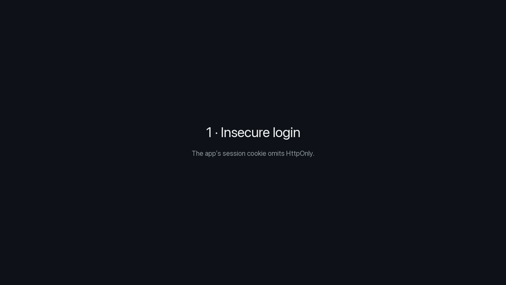

<div align="center">

# CookieGuard AI

### Cookie security checks for AI browser agents, MCP clients, tests, and CI.

**A successful agent login is not a secure session cookie.**

[](https://pypi.org/project/cookieguard/)
[](https://pepy.tech/projects/cookieguard-browser-use)
[](https://pypi.org/project/cookieguard/)
[](https://www.npmjs.com/package/cookieguard-ci)
[](https://www.npmjs.com/package/cookieguard-ci)
[](https://www.npmjs.com/package/@aiscihub/cookieguard-mcp)
[](integrations/python/docs/install.md)
[](https://github.com/browser-use/browser-use)
[](https://github.com/aiscihub/cookieguard-ai/actions/workflows/cookieguard-ci.yml)
[](LICENSE)
[](https://girlswhocode.com/news/gwc-challenge-2026-winners)

**[Browser Use integration](integrations/python/README.md) · [MCP server](packages/mcp/README.md) · [CI guide](docs/CI_GUIDE.md) · [Website](https://aiscihub.github.io/cookieguard-ai/)**

[Quick start](#quick-start) · [How it works](#how-it-works) · [Your policy](#your-policy-decides-what-fails) · [What it checks](#what-it-checks) · [MCP](#use-it-from-an-mcp-client) · [Coding agents](#use-it-from-a-coding-agent) · [More tools](#more-ways-to-use-cookieguard) · [FAQ](#faq) · [Documentation](#documentation)

<code>pip install cookieguard==0.4.0</code>

</div>

> [!NOTE]
> CookieGuard for Browser Use is a community integration, not an official Browser Use
> package. Audit only applications you are authorized to test.

<div align="center">

<br />



<sub>Real run: Claude (<code>claude-opus-5-5</code>) drives a Browser Use agent through the same login twice.
The insecure app gets <b>FAIL — CG001</b> (exit 1); the secure app gets <b>PASS</b> (exit 0).
<a href="integrations/python/docs/demo-and-tests.md">Recording and test evidence</a></sub>

<br /><br />

</div>

---

Your AI agent can log in to an app successfully while the session cookie it receives
is still unsafe, for example readable by JavaScript because it lacks `HttpOnly`.
CookieGuard watches the browser the agent drives, checks the authentication cookies
against your policy, and returns **PASS / FAIL / INCOMPLETE** with rule IDs,
explanations, and fixes.

The decision comes from the local CookieGuard engine and is enforced by your code,
never by the model. Cookie values stay on your machine: they never reach the model,
logs, or reports.

## Quick start

### Install

Needs **Python 3.11+, Node.js 24+, and Chrome or Chromium**. Install the
[published 0.4.0 release](docs/RELEASE_0.4.0.md):

```bash
pip install cookieguard==0.4.0
```

Code that uses `cookieguard-browser-use` or `import cookieguard_browser_use` keeps working:
that package now installs `cookieguard` and re-exports it.

### Try the demo

Runs a real Browser Use agent against a local login app, with no API key needed:

```bash
python -m cookieguard.browser_use.demo   # insecure: FAIL CG001 (exit 1) · secure: PASS (exit 0)
```

### Add it to your agent

```python
from browser_use import Agent, BrowserProfile, BrowserSession, Tools
from cookieguard import CookieGuardAudit

audit = CookieGuardAudit(
    allowed_origins=['http://127.0.0.1:3000'],  # exact origins you are authorized to test
    auth_cookies=['session_id'],                # the real session cookie name(s)
    fail_on='high',
)
session = BrowserSession(browser_profile=BrowserProfile(
    keep_alive=True,                            # required: Agent.run() otherwise closes the browser
    enable_default_extensions=False,            # avoid the bundled cookie-consent extension
    allowed_domains=audit.browser_allowed_domains(),
))
tools = Tools()
audit.register_tools(tools)                     # optional agent-visible check

await session.start()
await audit.start(session)                      # before the login
agent = Agent(task=..., llm=..., browser_session=session, tools=tools,
              sensitive_data={'http://127.0.0.1': {'login_password': '...'}})
await agent.run()
result = await audit.finish()                   # decided by the CookieGuard engine
await session.kill()

print(result.summary)
result.assert_policy()                          # raises CookiePolicyError on FAIL or INCOMPLETE
```

`assert_policy()` raises on FAIL or INCOMPLETE even if the agent never called the
audit tool, or reported success.
[Install guide](integrations/python/docs/install.md) · [Real-model example](integrations/python/examples/agent_login.py)

Version 0.4.0 enables minimal [usage reporting](docs/USAGE_METRICS.md) for accepted
audits by default. Set `COOKIEGUARD_USAGE_METRICS=0`, `DO_NOT_TRACK=1`, or
`usage_metrics=False` to disable it. Cookie data and audit results are never sent.

## How it works

<picture>
  <source media="(max-width: 600px) and (prefers-color-scheme: dark)" srcset="integrations/python/docs/how-it-works-dark-mobile.svg">
  <source media="(max-width: 600px)" srcset="integrations/python/docs/how-it-works-light-mobile.svg">
  <source media="(prefers-color-scheme: dark)" srcset="integrations/python/docs/how-it-works-dark.svg">
  
</picture>

CookieGuard reads the agent's browser over its own connection. It sees both what the
server declared (`Set-Cookie`) and what the browser stored. The published CookieGuard
engine then evaluates that evidence locally.
[Details](integrations/python/docs/how-it-works.md)

## Your policy decides what fails

<picture>
  <source media="(max-width: 600px) and (prefers-color-scheme: dark)" srcset="integrations/python/docs/policy-dark-mobile.svg">
  <source media="(max-width: 600px)" srcset="integrations/python/docs/policy-light-mobile.svg">
  <source media="(prefers-color-scheme: dark)" srcset="integrations/python/docs/policy-dark.svg">
  
</picture>

`fail_on` sets the line: a confirmed finding at or above it fails the run; anything
below is reported. Only cookies you name in `auth_cookies` can be confirmed.
[All policy options](integrations/python/docs/policy.md)

## What it checks

| Rule | Checks | Severity | Policy option |
| --- | --- | --- | --- |
| CG001 | Authentication cookie missing `HttpOnly` | high | always on |
| CG002 | Authentication cookie missing `Secure` | high | always on |
| CG003 | Declared `SameSite` outside the policy | medium | `allowed_same_site`, `require_explicit_same_site` |
| CG004 | `Domain=` shares the cookie with subdomains | medium | review unless `require_host_only` |
| CG005 | Remaining lifetime above the limit | medium | `max_lifetime_days` |
| CG006 | Invalid `__Host-` / `__Secure-` prefix | high | always on |
| CG007 | A protection regressed since a baseline | high | `finish(baseline=…)` |
| CG008 | Authentication role not confirmed | review | name it in `auth_cookies` |
| CG009 | Evidence needs review | review | — |
| CG010 | Session id not rotated at login | high | opt-in `session_probe_url` |
| CG011 | Session still valid after logout | high | opt-in `session_probe_url` |
| CG012 | Token in `localStorage` or `sessionStorage` | high | review; confirmed with `auth_storage_keys` |

CG001–CG009 check cookie configuration. CG010 and CG011 replay the observed session
against one protected URL you name, and CG012 reads Web Storage in the audited browser
(Python 0.3.0 and Playwright 0.3.0). PASS means the
configured checks passed, not that the application is secure.
[Full rule table](docs/CI_GUIDE.md#supported-checks) · [Limits & privacy](integrations/python/docs/limits-and-privacy.md)

## More ways to use CookieGuard

The same published policy engine powers every tool:

| Tool | Use it for | Get started |
| --- | --- | --- |
| **Browser Use** | AI agents that log in and run browser workflows | [Quick start](#quick-start) |
| **MCP server** | Letting an AI client scan your app's `Set-Cookie` headers | [Use it from an MCP client](#use-it-from-an-mcp-client) |
| **Agent Skill** | Teaching coding agents when and how to add these checks | [Use it from a coding agent](#use-it-from-a-coding-agent) |
| **Playwright** | Cookies created during login in your existing tests | [Playwright quickstart](docs/CI_GUIDE.md#quick-start-playwright) |
| **Playwright gate** | Failing CI unless the login check ran and passed, even if a test was skipped | [Gate example](examples/playwright-gate) |
| **CLI** | `Set-Cookie` headers from a running test app | [CLI quickstart](docs/CI_GUIDE.md#quick-start-cli) |
| **GitHub Action** | Header checks, a build summary, and a sanitized report | [Action quickstart](docs/CI_GUIDE.md#quick-start-github-actions) |
| **Browser extension** | Inspecting cookies interactively in Chrome | [See below](#browser-extension) |

With **Node.js 24+**, scan a local endpoint that sets your authentication cookie:

```bash
npx cookieguard-ci@0.4.0 scan http://localhost:3000 --auth-cookie session_id
```

The CLI, Action, and MCP server do not log in or execute JavaScript. Use Browser Use or
Playwright for authenticated workflows. Every tool reports **0** for a pass, **1** for a
confirmed policy failure, and **2** for an incomplete audit. The MCP server reports it as
the `exitCode` result field.

### Use it from an MCP client

The CookieGuard MCP server lets an AI client, such as a coding agent, check the cookies
your app sets. It runs locally over stdio. Your configuration file fixes the allowed
origins and policy; the client can only choose which URL or evidence file to audit.

> [!NOTE]
> [`@aiscihub/cookieguard-mcp`](https://www.npmjs.com/package/@aiscihub/cookieguard-mcp)
> 0.4.0 is published on npm and active in the official MCP Registry as
> `io.github.aiscihub/cookieguard`. See the [release record](docs/RELEASE_0.4.0.md).
> It needs Node.js 24+.

[](https://mcprush.com/to/cookieguard-mcp?ref=badge) [](https://glama.ai/mcp/servers/aiscihub/cookieguard-ai)

Try it from a clone of this repository, with no API key or browser. The demo connects a
real MCP client to the server:

```bash
npm ci && npm run demo:mcp
```

```text
MCP tools: cookieguard_audit, cookieguard_capabilities, cookieguard_explain, cookieguard_policy, cookieguard_scan
Capabilities: 9 checks; allowed origins: 1; evidence files: enabled
secure: PASSED (exitCode 0)
missing-httponly: FAILED (exitCode 1) — CG001 Missing HttpOnly
preference: INCOMPLETE (exitCode 2) — expected-auth-cookie-not-observed
Explain CG001: Set HttpOnly on the authentication cookie at the server.
Evidence login-report.json: FAILED (exitCode 1); observed by server: no
```

To connect your own client, write a config file
(like [this example](examples/mcp/cookieguard.example.json)) with your app's origin and
session cookie names. Then add the server to your client's MCP settings:

```json
{
  "mcpServers": {
    "cookieguard": {
      "command": "npx",
      "args": ["--yes", "@aiscihub/cookieguard-mcp@0.4.0",
               "--config", "/absolute/path/cookieguard.json"]
    }
  }
}
```

| Tool | What it does | Available in |
| --- | --- | --- |
| `cookieguard_policy` | Shows the allowed origins and the policy in force | 0.1.0 |
| `cookieguard_scan` | Scans one allowed URL's `Set-Cookie` headers and returns status, findings, and fixes | 0.1.0 |
| `cookieguard_capabilities` | Describes the checks, this server's configuration, result meanings, and limits | 0.2.0 |
| `cookieguard_audit` | Audits one allowed URL, or one sanitized report your own Browser Use, Playwright, or CLI run wrote to the configured `evidenceDir` | 0.2.0 |
| `cookieguard_explain` | Explains a rule ID, incomplete reason, or error code | 0.2.0 |


Results never contain cookie values. The agent decides whether to call the tool, so
enforce results in your tests or CI when you need a gate.
[MCP guide](packages/mcp/README.md)

### Use it from a coding agent

The [CookieGuard Agent Skill](skills/cookieguard-browser-auth-security/SKILL.md) tells coding agents when a task
calls for these checks (Browser Use or Playwright logins, CI gates, MCP clients), which
integration to pick, and how to read the result without exposing cookie values. In
Claude Code:

```text
/plugin install cookieguard --marketplace aiscihub/cookieguard-ai
```

For Codex, copy [`skills/cookieguard-browser-auth-security`](skills/cookieguard-browser-auth-security) to `.agents/skills/` in your
repository or to `~/.agents/skills/`. Other agents that read `SKILL.md` can use the same
folder, and `npm run package:skill` builds a ZIP of it for skill marketplaces.

Automated tools can read [`cookieguard.capabilities.json`](cookieguard.capabilities.json):
a versioned, machine-readable description of every check, input, output schema, exit
code, privacy property, and limitation. Output schemas are in [`schemas/`](schemas).
`npx cookieguard-ci@0.4.0 capabilities --json` and `npx cookieguard-ci@0.4.0 explain CG001`
print the same information.
[Agent discovery details](docs/agent-discovery.md)

### Browser extension

<details>
<summary>Install the original CookieGuard AI Chrome extension</summary>

<br />

Its classifier and explanations run in your browser, with no backend required.

1. Download or clone this repository.
2. Open `chrome://extensions/` and enable **Developer mode**.
3. Select **Load unpacked**, then choose the `extension-standalone/` folder.
4. Open a site you are authorized to inspect, click CookieGuard AI, and select **Scan Cookies**.

The popup shows **AI Engine Ready** or **Rule-Based Mode**.


Extension JSON exports can include cookie values; review them before sharing.
[Extension and research background](docs/ORIGINAL_README.md) · [Privacy](PRIVACY.md)

</details>

## FAQ

<details>
<summary><strong>Does the AI model decide whether my app passes?</strong></summary>

<br />

No. Your code calls `audit.finish()` and `assert_policy()`; the local CookieGuard engine
decides. The agent's optional `cookieguard_audit` tool is read-only and provisional. In
testing, an agent that falsely claimed success without logging in still got INCOMPLETE.

</details>

<details>
<summary><strong>Do cookie values reach the model, logs, or reports?</strong></summary>

<br />

No. Values go only to the local engine over a pipe, and every result is value-free. The
tests check this with synthetic tokens. Your model provider still receives the task and
page content. Pass credentials through Browser Use `sensitive_data`, and set
`ANONYMIZED_TELEMETRY=false` to turn off Browser Use telemetry.
[Limits & privacy](integrations/python/docs/limits-and-privacy.md)

CookieGuard 0.4.0 adds separate [usage reporting](docs/USAGE_METRICS.md), enabled
by default for accepted audit invocations. It attempts one minimal PostHog event,
without cookie data, URLs, audit results, or persistent identity. Disable it before
starting the process with `COOKIEGUARD_USAGE_METRICS=0` or `DO_NOT_TRACK=1`, or use
the API's explicit `false` setting. Downloads and imports do not report. Existing
npm and Python 0.3.0 installations remain unchanged until upgraded.

</details>

<details>
<summary><strong>Browser Use or MCP: which should I use?</strong></summary>

<br />

Use **Browser Use** when an agent logs in and you need the browser's evidence: it sees the
cookies created during the real workflow, and your code enforces the result. Use the **MCP
server** to let an AI client check the `Set-Cookie` headers an endpoint returns, without a
browser or login. Its result is information for the agent, not an enforced gate.

</details>

<details>
<summary><strong>Which models work?</strong></summary>

<br />

Any model Browser Use supports. Verified with `claude-opus-5-5`, using Anthropic's
server-side fallback for intermittent safety-classifier refusals. The OpenAI and Browser
Use Cloud paths in the [example](integrations/python/examples/agent_login.py) have
not been run yet. The demo needs no model at all.

</details>

<details>
<summary><strong>Can I audit a staging site?</strong></summary>

<br />

Only one you are authorized to test. Loopback origins are allowed by default. Others
need their exact origin plus `allow_nonlocal_origins=True`. CookieGuard never
navigates; use `allowed_domains` to keep the agent on the app.

</details>

<details>
<summary><strong>Why does Chrome exit at launch on Ubuntu 24.04 or GitHub Actions?</strong></summary>

<br />

Ubuntu 23.10+ blocks the user namespaces Chromium's sandbox needs. Run
`sudo sysctl -w kernel.apparmor_restrict_unprivileged_userns=0`, or use Google Chrome with
`BrowserProfile(channel='chrome')`. Avoid `--no-sandbox`.
[Install guide](integrations/python/docs/install.md)

</details>

<details>
<summary><strong>Which environments are tested?</strong></summary>

<br />

Version 0.1.0 is tested with Browser Use 0.13.14 and Chromium-family browsers:
- **Linux (GitHub `ubuntu-latest`):** Python 3.11, 3.12, and 3.13, Node.js 24, Chromium 156.
- **macOS (Apple silicon):** Python 3.12, Node.js 24 and 26, Chrome 156.

Windows, Browser Use cloud browsers, and other Browser Use versions are not tested yet.
[Tested environments and dependencies](integrations/python/docs/limits-and-privacy.md#tested-environments-and-dependencies)

</details>

## Documentation

| Area | Guides |
| --- | --- |
| Browser Use | [Overview](integrations/python/README.md) · [Install](integrations/python/docs/install.md) · [Policy](integrations/python/docs/policy.md) · [How it works](integrations/python/docs/how-it-works.md) · [Results](integrations/python/docs/results.md) · [Limits & privacy](integrations/python/docs/limits-and-privacy.md) · [Demo & tests](integrations/python/docs/demo-and-tests.md) · [Validation](integrations/python/VALIDATION.md) |
| MCP server | [Guide](packages/mcp/README.md) · [Validation](packages/mcp/VALIDATION.md) · [Release checklist](packages/mcp/RELEASING.md) · [Example config](examples/mcp/cookieguard.example.json) |
| CI tools | [CI guide](docs/CI_GUIDE.md) · [Playwright demo](docs/CI_GUIDE.md#watch-the-playwright-demo) · [Validation](docs/CI_VALIDATION.md) · [Architecture](docs/CI_ARCHITECTURE.md) |
| Extension & research | [Original README](docs/ORIGINAL_README.md) · [Project summary](PROJECT_SUMMARY.md) · [Historical report](https://aiscihub.github.io/cookieguard-ai/report.html) |
| Project | [Release notes](CHANGELOG.md) · [Contributing](CONTRIBUTING.md) · [Troubleshooting](docs/CI_GUIDE.md#contributing-and-troubleshooting) · [Security](SECURITY.md) · [Privacy](PRIVACY.md) |

## Project

The original CookieGuard AI extension won the **Girls Who Code Challenge 2026**:
[award announcement](https://girlswhocode.com/news/gwc-challenge-2026-winners) ·
[original demo](https://www.youtube.com/watch?v=_PhzLN31C04).
CookieGuard is released under the [MIT license](LICENSE).
