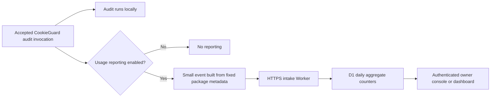

# CookieGuard usage metrics proposal

**Status update, November 13, 2026:** the 0.4.0 release candidate implements a default-on
PostHog pilot covering Python, CLI, Playwright, MCP, and GitHub Action, with an
explicit helper for direct core use. See [current setup, schema, and privacy
controls](USAGE_METRICS.md). Accepted audit invocations attempt reporting to US
Cloud project `735326` using the bundled public token. `COOKIEGUARD_USAGE_METRICS=0`,
`DO_NOT_TRACK=1`, or an explicit API `false` disables reporting. Publication is
pending; npm and Python 0.3.0 installations remain unchanged. The implemented
CLI hook covers both accepted `scan` and `gate` commands.
The proposal below, including its original default-off recommendation, is
retained as investigation history, not the current rollout instructions.

Investigated November 13, 2026. No package instrumentation,
collector, database, or external deployment was created during that investigation.
The proposal records the investigation at that time. Source links below have
been updated for the canonical Python layout; the original collector choice and
example payload remain historical, not the current PostHog contract.

**Recommendation:** start with optional, content-free invocation reporting in the
Python integration, sent to a small Cloudflare Worker that increments daily
counters in D1. Read the first results through Cloudflare's authenticated SQL
console; add a private dashboard when useful. Expand to the CLI, Playwright, MCP,
and GitHub Action after the shared counting and privacy behavior is verified.

This answers “is CookieGuard being used, how often, through which integration,
and on which versions?” It intentionally does not identify users, installations,
repositories, websites, or cookies. The correct dashboard label is **reported
audit invocations**, not users, installations, or every execution.



The audit proceeds independently of delivery. A collector outage, blocked
network, or exhausted service quota must never change a security verdict or
prevent an audit from running.

The current website uses GitHub Pages. That is static hosting, so it cannot by
itself accept and store usage POST requests; a separate service is required.
A persistent Workers endpoint would be independent of the temporary tunnels
used in the Browser Use demo. [GitHub Pages documentation](https://docs.github.com/en/pages/getting-started-with-github-pages/what-is-github-pages)

The current code has useful places to add reporting:

| Surface | Proposed measurement point | Avoid counting again |
|---|---|---|
| Python `cookieguard` / `cookieguard-browser-use` | Once in `CookieGuardAudit._start()`, after accepting the lifecycle and session configuration, before starting the audit work | Imports, construction, provisional `check()`, `finish()`, result writing, and policy assertion |
| Browser Use agent tool | Optional separate `agent_check_invoked` metric in `_agent_check()` after active-session validation | Do not add these calls to the audit-workflow total |
| CLI | Accepted `scan` dispatch in `runCli()` | Help, version, capabilities, explain, the HTTP collector, and core evaluation |
| Playwright | Once when a collector first collects/evaluates, guarded by its existing memoized lifecycle | `auditPage()` delegation and repeated collection/evaluation |
| MCP | Shared guarded audit operation after admission | Legacy scan alias, nested scanner/core calls, BUSY rejections, static discovery/explanation tools |
| GitHub Action | Accepted audit in its `main()` | The scanner and core engine it calls directly |
| Direct core API | Explicit instrumented wrapper if this coverage is wanted | Keep the synchronous core evaluator free of automatic network side effects |

Relevant implementation locations are
[`CookieGuardAudit`](../integrations/python/src/cookieguard/browser_use/_audit.py),
[`runCli`](../packages/cli/src/main.js),
[`Playwright collector`](../packages/playwright/src/index.js),
[`MCP dispatcher`](../packages/mcp/src/index.js),
[`Action`](../action/run.js), and
[`core evaluator`](../packages/core/src/policy.js).

The [`cookieguard-browser-use` compatibility package](../integrations/python/compat/cookieguard-browser-use/src/cookieguard_browser_use/__init__.py)
re-exports the canonical `cookieguard` class. Instrument the implementation once
and label its traffic as package `cookieguard`, integration `browser-use`. Do not
claim to know which import spelling a caller used, or count the two PyPI
distributions as two uses. The implementation lives in `integrations/python/`.

The Python integration launches a nested Node engine, which may evaluate policy
several times during one workflow. Its explicit
[`child_env()`](../integrations/python/src/cookieguard/_engine.py)
should force CookieGuard usage reporting off in that child. Preserve the existing
engine network restrictions and the separate ONNX telemetry opt-out. Do not add a
sender to the vendored engine or relax its sandbox. Similarly, an MCP invocation
that uses the CLI scanner and core engine must still count only once.

**Define an invocation before implementing it.** For Python, count one accepted
start attempt per audit instance, including an attempt that subsequently fails to
attach. Repeated or invalid lifecycle calls do not count. For other surfaces,
count the accepted top-level audit operation. A start event does not establish
completion or successful security validation. If completed-audit counts are later
needed, introduce a separately named event with an idempotent terminal hook;
instrumenting only `finish()` would miss cancelled or abandoned workflows.

An illustrative event is:

```json
{
  "schema_version": 1,
  "event": "audit_invoked",
  "package": "cookieguard-browser-use",
  "package_version": "0.1.0",
  "integration": "browser-use"
}
```

This illustrates the format, not traffic sent by the existing release. The client
must obtain its version from installed package metadata, not this example. The
collector supplies the receipt time and UTC day. There is no need to collect
the client's clock, operating system, runtime version, or a persistent ID for the
initial question of whether the package is being used.

Use a dedicated event constructor accepting only these fields. Never serialize
an `AuditResult`, configuration object, exception, command line, or collector
statistics and then try to redact it. Existing reports are value-free but can
still contain cookie names, domains, paths, origins, findings, and evidence.

Exclude cookies and cookie attributes, URLs, hosts, filenames, repository names,
credentials, agent prompts, screenshots, raw errors, device fingerprints, and
user/installation IDs. Exclude verdicts and finding counts in the first version
too: they describe the audited application and are unnecessary for invocation
metrics. Runtime-major breakdowns or completion metrics can be considered later
as distinct, documented additions.

The intake should accept only POST JSON with a small body limit (for example
512 bytes), reject unknown fields, allowlist package/event/integration values,
and validate versions against maintained release metadata. Reject or bucket
unknown versions rather than allowing arbitrary strings to create unlimited
database dimensions. Increment by exactly one; do not accept a client-supplied
counter. Use a fixed HTTPS endpoint, reject redirects, and send no cookies,
authorization context, custom application headers, or caller-provided URL.

For the MVP, send once per accepted invocation with **no automatic retries or
durable queue**. An in-process guard prevents duplicate hooks; receiver totals
count accepted requests. This favors simplicity and data minimization over
guaranteed delivery. If retries become necessary, add a fresh random event ID
per invocation and bounded deduplication retention. Such an ID must never be
reused across invocations or derived from a machine, user, or repository.

**Reporting mode is a product decision.** I recommend default-off reporting
enabled through a trusted application setting or `COOKIEGUARD_USAGE_METRICS=1`.
Any explicit disable, including `COOKIEGUARD_USAGE_METRICS=0` or `DO_NOT_TRACK=1`,
should win over enablement. MCP reporting configuration belongs in process
startup settings, not arguments an agent can select for an individual audit.
No prompt is necessary on each run.

Default-on reporting would improve coverage among connected installations, but
it would change the existing default network/privacy contract and needs an
explicit release decision, clear disclosure, and a straightforward disable
mechanism. Neither mode can guarantee every use: old releases, offline runs,
blocked requests, opt-outs, abrupt exits, and modified clients remain unobserved.

The repository currently says “no telemetry” or “no analytics” in
[`PRIVACY.md`](../PRIVACY.md), the
[`CLI README`](../packages/cli/README.md),
[`CI guide`](CI_GUIDE.md), and
[`machine-readable capabilities`](../packages/cli/src/capabilities.js).
Even opt-in reporting requires updating those statements to describe the exact
choice and fields. Keep capability JSON copies generated from their source in
sync. The Browser Use privacy page's existing telemetry controls concern the
upstream framework; they are not a CookieGuard reporting setting.

A content-free event is not a guarantee that infrastructure sees no identifying
metadata: a network connection exposes its source IP to the receiving service.
The application should not persist IPs, forwarded headers, User-Agent details,
geolocation, or raw requests. Disable request/invocation logs and tracing that
would retain them; review the hosting provider's own handling separately. New
Workers enable observability by default, so this requires explicit configuration.
[Workers Logs documentation](https://developers.cloudflare.com/workers/observability/logs/workers-logs/)

Transport should be best-effort and bounded. Use a small bounded queue, no
unbounded retry worker, and a short delivery budget (initial target: 500 ms).
Avoid keeping an application alive merely to send telemetry. Python can use a
single bounded daemon worker; Node needs an implementation whose handles do not
keep the main process alive, such as an unreferenced worker. Verify shutdown
behavior experimentally: an abort timer alone does not prove DNS or socket work
cannot delay exit. Disabled reporting must create no worker, timer, file, DNS
lookup, or socket. MCP stdout must remain exclusively protocol traffic; delivery
failures must not pollute stderr or enter model-visible results either.

The collection options are:

| Option | Current entry cost and relevant limits | Fit |
|---|---|---|
| Cloudflare Worker + D1 | Free Worker: 100,000 requests/day. Free D1: 100,000 rows written/day and 5 million read/day. Workers Paid starts at $5/month. | Recommended for a small, explicitly controlled aggregate schema; initially use the authenticated SQL console. |
| PostHog Cloud | 1 million analytics events/month free; anonymous-event paid pricing starts at $0.00005/event. | Fastest route to ready-made trends and dashboards; more careful configuration and event retention to manage. |
| Supabase Edge Function + Postgres | Free: 500,000 function invocations/month and 500 MB database. Pro starts at $25/month. | Reasonable if an existing Supabase project is available; otherwise more infrastructure than this feature needs. |

Prices and quotas were checked on the investigation date and can change.
[Workers pricing](https://developers.cloudflare.com/workers/platform/pricing/),
[D1 pricing](https://developers.cloudflare.com/d1/platform/pricing/),
[PostHog pricing](https://posthog.com/product-analytics/pricing),
[Supabase pricing](https://supabase.com/pricing).

For Cloudflare, D1 counts actual rows written, including updates, deletes, and
relevant index changes. Its free write quota is not a guaranteed number of events.
Benchmark the proposed UPSERT and maintenance operations before assigning an
event capacity. For an illustrative 2 million events/month, the $5 Workers paid
plan could cover the collector if request, CPU, D1 writes, storage, dashboard,
and maintenance stay within the included quotas. This is a conditional estimate,
not a bill or spending guarantee. On the same assumptions, PostHog's first paid
anonymous tier would be about $50 for the million events above its free tier.
[D1 billing details](https://developers.cloudflare.com/d1/platform/pricing/),
[Workers included usage](https://developers.cloudflare.com/workers/platform/pricing/),
[PostHog anonymous-event pricing](https://posthog.com/product-analytics/pricing).

The recommended backend stores a small aggregate table:

```sql
CREATE TABLE usage_daily (
  day TEXT NOT NULL,
  package TEXT NOT NULL,
  package_version TEXT NOT NULL,
  integration TEXT NOT NULL,
  event TEXT NOT NULL,
  invocation_count INTEGER NOT NULL DEFAULT 0,
  PRIMARY KEY (day, package, package_version, integration, event)
);
```

Use a prepared `INSERT ... ON CONFLICT ... DO UPDATE` to increment the matching
counter atomically. Do not read-modify-write a counter in separate application
requests. There is no raw-event table in this MVP. D1 exposes bindings and
prepared statements to Workers and provides an authenticated dashboard SQL
console. [D1 API](https://developers.cloudflare.com/d1/worker-api/d1-database/),
[D1 setup and SQL console](https://developers.cloudflare.com/d1/get-started/).

Proposed routes are public `POST /v1/usage`, and a separately protected dashboard
and aggregate-read API. A separate dashboard Worker behind Cloudflare Access
keeps the authentication boundary simple: protecting the intake itself would
prevent ordinary packages from reporting. Database bindings and administrator
credentials remain server-side. No database key or private account token belongs
in a distributed package. [Workers and Access](https://developers.cloudflare.com/workers/configuration/cloudflare-access/)

The owner view should show reported invocations today, the last 7 and 30 days,
daily trend, integration breakdown, package-version adoption, and the reporting
mode/release date. It should not show “active users” or failure rates from the
invocation-only event. Proposed retention is 13 months for aggregate counters,
with a scheduled deletion job. D1 recovery history persists beyond application
deletion: Time Travel retains 7 days on Free or 30 days on Paid. Account for that
when describing retention. [D1 Time Travel](https://developers.cloudflare.com/d1/reference/time-travel/)

If PostHog is chosen instead, use its HTTP capture interface without browser
autocapture or session replay. Set `$process_person_profile` to false, use a new
random `distinct_id` for each invocation, and chart total events rather than
unique users. Configure IP discard and disable GeoIP transformation/enrichment;
IP discard alone does not disable enrichment. Keep the dashboard private.
Its free retention is one year, which is less flexible than our own aggregate
table. [Capture API](https://posthog.com/docs/api/capture),
[data collection controls](https://posthog.com/docs/privacy/data-collection),
[retention](https://posthog.com/docs/data/events-retention).

Any public package collector is an unauthenticated measurement channel. A secret
embedded in open-source client code cannot prove that a genuine audit happened.
Schema validation, body limits, bounded dimensions, rate limiting, anomaly
review, and spending controls reduce abuse; they cannot prevent all forged
counts. Coarse IP-based rate limiting would itself process IP metadata, even if
we store none in the metrics database. Cloudflare's built-in rate limiter is
approximate and local to each location, so it must not be presented as a global
hard budget cap. [Rate-limiter behavior](https://developers.cloudflare.com/workers/runtime-apis/bindings/rate-limit/)

Implementation can proceed in this order:

1. Decide reporting mode and freeze the invocation definition and allowlisted
   schema. Start with Python audits; optionally measure agent tool calls as a
   separate event later.
2. Build the intake and aggregate storage locally with synthetic events. Verify
   concurrent increments, schema rejection, retention, owner-only read access,
   and quota/failure behavior. Choose the permanent endpoint and collector
   account before packaging a client.
3. Add the Python hook and bounded sender; explicitly disable nested Node
   reporting. Add CLI, MCP, Playwright, and Action ownership hooks in a later
   change if desired. Preserve core's pure synchronous behavior.
4. Add privacy and delivery tests. Assert the exact outbound fields using hostile
   synthetic cookie/URL/credential canaries; verify no traffic when disabled,
   one event across aliases and nested helpers, no counting of provisional
   evaluations as new audits, and unchanged verdicts/exit codes during network
   failure. Test CLI/MCP shutdown and protocol output.
5. Update privacy text, capability schemas and generated copies, public API
   declarations, and release notes. Validate the collector using a canary release,
   then publish the opted-in feature under the chosen rollout policy. Production
   deployment and package publication remain separate actions from this investigation.

The decisions still needed before implementation are the reporting default,
whether phase one covers only Python or all adapters, and which account will host
the collector. No application cookie data or stable installation identifier is
needed to deliver the proposed invocation dashboard.
