# How it works

[Overview](../README.md) · [Install](install.md) · [Policy](policy.md) · **How it works** · [Results](results.md) · [Limits & privacy](limits-and-privacy.md) · [Demo & tests](demo-and-tests.md)

<picture>
  <source media="(max-width: 600px) and (prefers-color-scheme: dark)" srcset="how-it-works-dark-mobile.svg">
  <source media="(max-width: 600px)" srcset="how-it-works-light-mobile.svg">
  <source media="(prefers-color-scheme: dark)" srcset="how-it-works-dark.svg">
  
</picture>

- **Server declarations:** `Set-Cookie` lines from `Network.responseReceivedExtraInfo`,
  attributed to their redirect hop and filtered to your authorized origins.
- **Browser state:** `Storage.getCookies` (HttpOnly, Secure, SameSite, domain, path, expiry, partitioning).
- **Evaluation:** the published `@aiscihub/cookieguard-core` and `@aiscihub/cookieguard-playwright`
  0.1.0 packages, vendored unchanged and hash-verified. No Python copy of the rules.
- **Enforcement:** `audit.finish()` and `assert_policy()` in your code. The agent tool is optional,
  read-only, and cannot stop collection or change the result.
