# Choose a policy

[Overview](../README.md) · [Install](install.md) · **Policy** · [How it works](how-it-works.md) · [Results](results.md) · [Limits & privacy](limits-and-privacy.md) · [Demo & tests](demo-and-tests.md)

<picture>
  <source media="(max-width: 600px) and (prefers-color-scheme: dark)" srcset="policy-dark-mobile.svg">
  <source media="(max-width: 600px)" srcset="policy-light-mobile.svg">
  <source media="(prefers-color-scheme: dark)" srcset="policy-dark.svg">
  
</picture>

The policy is a set of `CookieGuardAudit` arguments, evaluated by the CookieGuard engine.
`fail_on` sets the line: a confirmed finding at or above it fails the run, and anything
below it is reported. Only cookies named in `auth_cookies` (or in validated `auth_evidence`)
can be confirmed; other cookies that look like sessions become review items (CG008).

A stricter policy for an authorized staging site:

```python
audit = CookieGuardAudit(
    allowed_origins=['https://staging.example.com'], allow_nonlocal_origins=True,
    auth_cookies=['__Host-session'],
    fail_on='medium',                 # SameSite and lifetime findings fail too
    require_explicit_same_site=True,  # Set-Cookie must declare SameSite
    require_host_only=True,           # a Domain= attribute fails (CG004)
    max_lifetime_days=7,
)
```

| Option | Default | Effect |
| --- | --- | --- |
| `allowed_origins` | required | Exact `http(s)://host[:port]` origins to collect evidence from; loopback only unless `allow_nonlocal_origins=True`. Max 20. |
| `auth_cookies` | `[]` | Exact session cookie names. Only these can be confirmed; a missing one makes the audit INCOMPLETE. |
| `fail_on` | `high` | `info`, `low`, `medium`, `high`, `critical`. CG001, CG002, CG006, CG007 are high; CG003, CG004, CG005 are medium. |
| `allowed_same_site` | `lax`, `strict` | A declared SameSite outside this list is CG003. |
| `require_explicit_same_site` | `False` | A `Set-Cookie` without SameSite is CG003. |
| `require_host_only` | `False` | A `Domain=` attribute is a confirmed CG004 instead of a review item. |
| `max_lifetime_days` | 30 | A longer remaining lifetime is CG005. |
| `auth_evidence` | `[]` | Identify a session cookie by exact name, domain, path, and origin, with `validation='server-session-validated'`. |
| `finish(baseline=old.report)` | none | Compare with an earlier result; a removed protection is CG007. |
| `capture_headers` | `True` | `False` = browser-observation-only mode (declarations stay unknown). |
| `require_header_evidence` | `= capture_headers` | An otherwise passing audit without a `Set-Cookie` for each expected cookie is INCOMPLETE. Never hides a FAIL. |
| `timeout_seconds` | 600 | Collection window (max 600); expiry makes the audit INCOMPLETE. |

Rule severities are fixed. Custom rules, per-rule switches, per-cookie policies, and policy
files are not supported. Details of every rule: [main README](../../../README.md#supported-checks).
