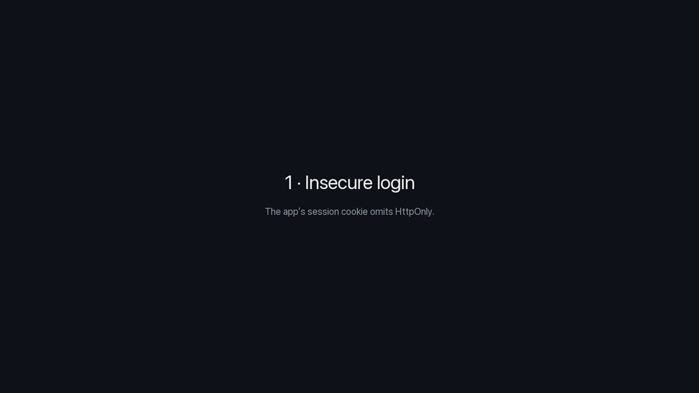

# CookieGuard for Python

`cookieguard` is CookieGuard's Python package. Integrations live under it; the first is
`cookieguard.browser_use`.

**A successful agent login is not a secure session cookie.** CookieGuard for
Browser Use watches the browser your [Browser Use](https://github.com/browser-use/browser-use)
agent drives, checks the authentication cookies it receives, and returns
**PASS / FAIL / INCOMPLETE** with rule IDs, explanations, and fixes. The decision comes
from the local [CookieGuard](../../README.md) policy engine, never from the model.

**Overview** · [Install](docs/install.md) · [Policy](docs/policy.md) · [How it works](docs/how-it-works.md) · [Results](docs/results.md) · [Limits & privacy](docs/limits-and-privacy.md) · [Demo & tests](docs/demo-and-tests.md)

## Your policy decides what fails

<picture>
  <source media="(max-width: 600px) and (prefers-color-scheme: dark)" srcset="docs/policy-dark-mobile.svg">
  <source media="(max-width: 600px)" srcset="docs/policy-light-mobile.svg">
  <source media="(prefers-color-scheme: dark)" srcset="docs/policy-dark.svg">
  
</picture>

`fail_on` sets the line: a confirmed finding at or above it fails the run; anything below
is reported. Only cookies you name in `auth_cookies` can be confirmed.
All options and a stricter example: **[Policy](docs/policy.md)**.

## See it run



Claude (`claude-opus-5-5`) drives a real Browser Use agent through the same login twice.
The insecure app's cookie lacks `HttpOnly`, so CookieGuard returns **FAIL — CG001** (exit 1).
The secure app gets **PASS** (exit 0). Recorded from a real run: **[Demo & tests](docs/demo-and-tests.md)**.

## Add it to your agent

```python
from browser_use import Agent, BrowserProfile, BrowserSession, Tools
from cookieguard import CookieGuardAudit

audit = CookieGuardAudit(
    allowed_origins=['http://127.0.0.1:3000'],  # exact origins you are authorized to test
    auth_cookies=['session_id'],                # the real session cookie name(s)
    fail_on='high',
)
session = BrowserSession(browser_profile=BrowserProfile(
    keep_alive=True,                            # required: Agent.run() otherwise closes the browser
    enable_default_extensions=False,            # avoid the bundled cookie-consent extension
    allowed_domains=audit.browser_allowed_domains(),
))
tools = Tools()
audit.register_tools(tools)                     # optional agent-visible check

await session.start()
await audit.start(session)                      # before the login
agent = Agent(task=..., llm=..., browser_session=session, tools=tools,
              sensitive_data={'http://127.0.0.1': {'login_password': '...'}})
await agent.run()
result = await audit.finish()                   # decided by the CookieGuard engine
await session.kill()

print(result.summary)
result.assert_policy()                          # raises CookiePolicyError on FAIL or INCOMPLETE
```

`assert_policy()` raises even if the agent never called the tool, or reported
success. `CookieGuardAudit` is also an async context manager; `close()` stops
collection without a result. One instance audits one workflow.

Needs Python 3.11+, Node.js 24+, and Chrome or Chromium: **[Install](docs/install.md)**.

Install [version 0.3.0 from PyPI](https://pypi.org/project/cookieguard/):

```bash
pip install cookieguard
```

Code that uses `cookieguard-browser-use` or `import cookieguard_browser_use` keeps working:
that package now installs `cookieguard` and re-exports it.

Status: `0.3.0`, tested with browser-use 0.13.14 on Linux (Python 3.11–3.13) and macOS (Python 3.12).
See [tested environments](docs/limits-and-privacy.md#tested-environments-and-dependencies).
This is a community integration, not an official Browser Use package.
