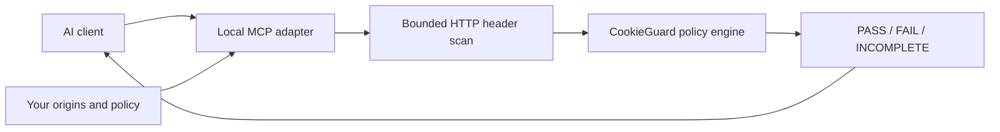

# CookieGuard MCP

Let an MCP client check HTTP cookie configuration against your local policy.
CookieGuard returns **PASS / FAIL / INCOMPLETE**, rule IDs, explanations, and fixes.
Cookie values never appear in tool results.

Version **0.4.0** adds default-on invocation reporting. Earlier releases are
available on npm and in the official MCP Registry as
`io.github.aiscihub/cookieguard`. Requires **Node.js 24+**. Version 0.3.0 updated the
engine (explanations for CG010–CG012, and session and Web Storage evidence in
`cookieguard_audit` evidence files); its tools are unchanged. Version 0.2.0 added
`cookieguard_capabilities`, `cookieguard_audit` (including sanitized evidence files), and
`cookieguard_explain`. See [Tools and results](#tools-and-results).

[](https://mcprush.com/to/cookieguard-mcp?ref=badge) [](https://glama.ai/mcp/servers/aiscihub/cookieguard-ai)



The client launches a local program and communicates over stdio. No cloud hosting,
API key, Python, or browser installation is needed. The adapter uses the existing
`cookieguard-ci` scanner and `@aiscihub/cookieguard-core` policy engine.

## Try the working demo

From a clone of this repository:

```bash
npm ci
npm run demo:mcp
```

The demo starts a local fixture and connects a real MCP SDK client to the server.
It reads the capabilities, audits three endpoints, explains the failure, audits a
report written by a separate CLI run, checks every outcome, and exits:

```text
MCP tools: cookieguard_audit, cookieguard_capabilities, cookieguard_explain, cookieguard_policy, cookieguard_scan
Capabilities: 9 checks; allowed origins: 1; evidence files: enabled
secure: PASSED (exitCode 0)
missing-httponly: FAILED (exitCode 1) — CG001 Missing HttpOnly
preference: INCOMPLETE (exitCode 2) — expected-auth-cookie-not-observed
Explain CG001: Set HttpOnly on the authentication cookie at the server.
Evidence login-report.json: FAILED (exitCode 1); observed by server: no
MCP demo passed; cookie-value canary absent from results and diagnostics.
```

The `preference` endpoint is incomplete because the configured `session_id` was not
observed. The demo itself exits 0 when every expected outcome is verified.

## Connect your MCP client

1. Install Node.js 24 or later.
2. Save a configuration file outside any directory your agent can modify.
3. Add the server command to your client's local stdio MCP configuration.

Example `/absolute/path/cookieguard.json`:

```json
{
  "allowedOrigins": ["http://127.0.0.1:3000"],
  "policy": {
    "authCookies": ["session_id"],
    "failOn": "high",
    "allowedSameSite": ["lax", "strict"],
    "requireExplicitSameSite": true,
    "requireHostOnly": true,
    "maxLifetimeDays": 30
  },
  "timeoutMs": 10000,
  "evidenceDir": "/absolute/path/cookieguard-evidence"
}
```

`evidenceDir` is optional and only used by `cookieguard_audit` (0.2.0+). Use your actual application origin and authentication-cookie names. An origin
contains scheme, host, and optional port, with no URL path, credentials, query,
or fragment. `localhost` and `127.0.0.1` are distinct origins. The allowlist is
required even for loopback; there is no default authorization for other local
services. At most 20 origins are accepted. Public remote origins must also be
explicitly configured; the scanner blocks private non-loopback addresses and
remote IPv6.

For clients that use an `mcpServers` JSON object:

```json
{
  "mcpServers": {
    "cookieguard": {
      "command": "npx",
      "args": [
        "--yes",
        "@aiscihub/cookieguard-mcp@0.4.0",
        "--config",
        "/absolute/path/cookieguard.json"
      ]
    }
  }
}
```

Replace the configuration path. The pinned version keeps the server from changing
until you update it. Use an absolute path to `npx` if your client cannot find it on
`PATH`. To run from a checkout instead, run `npm ci` in the repository root, set
`command` to `node`, and make
`/absolute/path/cookieguard-ai/packages/mcp/bin/cookieguard-mcp.js` the first argument
before `--config`. Client-specific configuration locations and wrapper keys vary; the
command and argument array above are the stdio launch settings. This release was
tested with the official MCP SDK client on Linux (Node.js 24) and macOS (Node.js 26);
desktop MCP clients have not been tested yet.

Ask your client: **“Read CookieGuard's policy, then scan
http://127.0.0.1:3000/secure and explain any confirmed failures.”** In a clone of this
repository, run `npm run demo` in another terminal to provide that fixture endpoint.

Restart the MCP server after changing configuration. The server loads a snapshot
at startup; neither a tool call nor an edit to the file changes a running policy.
An agent with shell access could still edit the configuration and restart the
process, so filesystem permissions and client permissions remain your boundary.

## Tools and results

| Tool | Arguments | Result | Available in |
| --- | --- | --- | --- |
| `cookieguard_policy` | `{}` | Allowed origins, resolved policy defaults, timeout, and scope | 0.1.0 |
| `cookieguard_scan` | `{"url":"http://127.0.0.1:3000/secure"}` | Status, exit code, counts, findings, limitations, and any scan error | 0.1.0 |
| `cookieguard_capabilities` | `{}` | Checks, this server's configuration, result semantics, integrations, privacy, and limits | 0.2.0 |
| `cookieguard_audit` | `{"url":"…"}` or `{"evidenceFile":"login.json"}` | Same result as `cookieguard_scan`, plus `provenance` | 0.2.0 |
| `cookieguard_explain` | `{"id":"CG001"}` | Meaning, confirmed versus review conditions, and fix for a rule, issue, error, or status | 0.2.0 |

Since 0.2.0, every finding also carries `evidenceSource` (`header` for a server
`Set-Cookie` declaration, `browser` for cookie-store metadata) and `identityBasis`
(developer configuration versus uncalibrated heuristics). Output schemas are published
in [`schemas/`](https://github.com/aiscihub/cookieguard-ai/tree/main/schemas).

### Evidence handoff for authenticated browser workflows

The server never attaches to a browser or reads another process's cookies. To audit a
login that only a browser can perform, run it in your own test code with the
[Browser Use integration](https://github.com/aiscihub/cookieguard-ai/tree/main/integrations/python)
(`result.write_json(path)`), the Playwright adapter (write `formatJson(await audit.evaluate())`), or
the CLI (`--output`). Write the
sanitized report into the configured `evidenceDir`, then call
`cookieguard_audit {"evidenceFile": "login.json"}`. The server reads only plain `.json`
names inside that directory (no paths or symlinks, at most 1 MiB), rebuilds the
value-free observations field by field, and evaluates them under its own startup policy.
Evidence for origins outside `allowedOrigins` is rejected, provisional or incomplete
collections stay incomplete, and results carry `provenance.observedByServer: false`,
because the server cannot verify who wrote the file.
`integrations/python/scripts/agent_discovery_e2e.py` runs this path end to end with
a real Browser Use agent and the Python MCP SDK.

Only `url` is accepted by the scan tool. Policy, headers, credentials, and origin
overrides are rejected. `timeoutMs` is a startup setting from 100 to 10000
milliseconds, defaulting to 10000. Only one scan runs at a time; an overlapping
call returns `BUSY` rather than queuing more network work.

The scan response includes identical JSON in `structuredContent` and its text
content block. Its `exitCode` is a result field, not the MCP server process's
exit status:

| `status` | `exitCode` | Meaning |
| --- | --- | --- |
| `passed` | 0 | Completed; no confirmed violations at or above `failOn` |
| `failed` | 1 | Confirmed cookie-policy violations at or above `failOn` |
| `incomplete` | 2 | Missing evidence or a scan that could not complete |

A policy failure is a successful tool execution (`isError: false`). A blocked
target, timeout, HTTP error, or busy server returns `isError: true`, incomplete,
and a fixed error code/message. SDK argument-validation failures return
`isError: true` and may have only text content. Always check both `isError` and
the structured status. Invalid startup configuration exits the process with 2
and writes a fixed diagnostic to stderr; normal stdout contains only MCP traffic.

Configure `authCookies` to identify your real authentication cookies. Without
that evidence, classifier guesses stay in review and do not become confirmed
authentication-cookie failures. Defaults and rules are described in the
[CI policy guide](https://github.com/aiscihub/cookieguard-ai/blob/main/docs/CI_GUIDE.md#quick-start-cli).

## Scope and privacy

- This is an HTTP GET header audit. It does not log in, execute JavaScript, read
  your browser's cookie store, or attach to another MCP server's browser session.
  Use the [Browser Use integration](https://github.com/aiscihub/cookieguard-ai/tree/main/integrations/python)
  or [Playwright adapter](https://github.com/aiscihub/cookieguard-ai/tree/main/packages/playwright)
  for authenticated browser evidence.
- GET requests can trigger application side effects. The tool is deliberately
  not advertised as read-only. Use endpoints you are authorized to test.
- Requests send no authentication headers or cookies, and response cookies are
  not replayed. Bodies are discarded. Redirects stay on the original origin,
  even when another origin is configured. The scanner allows at most five
  redirects, 32 KiB of response headers per request, and 1000 observations.
- Raw cookie values and raw HTTP data are not returned. Arbitrary observed
  cookie names, domains, and paths are also withheld to avoid reflecting remote
  secrets or instructions. Findings use per-scan `cookieId` identifiers and show
  `cookieName` only when it matches a configured `authCookies` name. Multiple
  scoped cookies with the same name have distinct IDs within a response.
- Responses include at most 100 findings. `omittedFindings` records truncation;
  summary counts and status cover every finding. Use the CLI's local report when
  you need full cookie metadata. IDs are not stable across scans.
- Configured origins, policy, the evidence directory path (when set), summary counts,
  and findings are visible to the client and may be sent to its model provider. Do not put secrets in config or
  tool arguments. The server creates no audit log or report file.
- The 0.4.0 [usage-reporting pilot](https://github.com/aiscihub/cookieguard-ai/blob/main/docs/USAGE_METRICS.md)
  defaults on and attempts one fixed event per admitted audit.
  A startup setting `"usageMetrics": false`,
  `COOKIEGUARD_USAGE_METRICS=0`, or `DO_NOT_TRACK=1` disables it. Tool arguments
  cannot change reporting; `"usageMetrics": null` or omission follows the
  environment/default. BUSY rejections, discovery tools, downloads, and imports
  do not count. Events contain fixed package/version/integration fields, a fresh
  random invocation ID, and fixed privacy controls, without tool arguments,
  origins, results, or stable identity. The bundled public token targets
  CookieGuard's US Cloud project `735326`. Delivery is best effort and never
  affects audits. Existing npm 0.3.0 installations remain unchanged until upgraded.
- A pass covers only these configured checks. MCP exposes a tool; it cannot force
  an agent to call it or enforce its result. Enforce results in your test runner
  or CI when you need a release gate. Baseline regression comparison is not
  exposed in this first adapter.

## Development and release

```bash
npm run test:mcp
npm run lint
npm run typecheck
npm run verify:mcp
```

`verify:mcp` installs packed artifacts into an isolated directory and runs the
same MCP demo against the installed binary. It packs the installed, locked runtime
dependencies and installs offline with an empty npm cache; it does not publish.
CI includes the MCP tests in `npm test` and the
packaged-consumer check in `npm run release:check`.

The official SDK serves both legacy initialization and the 2026-07-28 protocol
over stdio. Tests exercise both. Registry metadata is prepared in `server.json`;
see the [release checklist](https://github.com/aiscihub/cookieguard-ai/blob/main/packages/mcp/RELEASING.md)
for the separate npm and registry approval steps.
